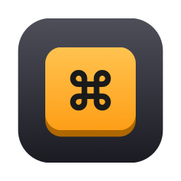

<p align="center"></p>

# Keyseek

A macOS menu bar app that searches the keyboard shortcuts and menu commands of whatever app is in front, and runs them.

Press the hotkey, start typing, press Enter. Esc puts you straight back where you were.

Keyseek works with any app, and has extra support for **Ableton Live 12**: about 290 shortcuts from the Live manual that never appear in a menu (single-key toggles, clip editor, browser, transport) are searchable and runnable too.

## What it does

- **Search** by action name (`ins trk`), by key (`f9`, `cmd shift t`) or by menu.
- **Run** the selected entry with Enter. Menu commands are pressed through the app's own menu bar; other shortcuts are sent as keystrokes.
- **Macros**: chain commands, keystrokes and pauses into one named action, built in a visual editor. Macros show up in the search list.
- **Macro shortcuts**: give a macro its own keyboard shortcut. It is only active while that macro's app is in front.
- **Starter macros for Live**, such as "Record on New Audio Track" and "Consolidate and Rename".

## Install

1. Download `Keyseek-x.y.z.zip` from the [Releases](../../releases) page and unzip it.
2. Move `Keyseek.app` to your Applications folder and open it.
3. Keyseek is not notarized by Apple, so macOS blocks the first launch. Open **System Settings > Privacy & Security**, scroll down, and click **Open Anyway** next to the Keyseek message.
4. When asked, grant **Accessibility** access (System Settings > Privacy & Security > Accessibility). Keyseek needs it to read an app's menus and to send keystrokes. Without it you only get the built-in shortcut list as a reference.

Requires macOS 13 or later. Runs on Apple silicon and Intel.

After updating to a new version you may have to grant Accessibility access again: remove Keyseek from the Accessibility list and add it back.

## Use

| | |
|---|---|
| Open or close the search panel | `⌃⌥Space` (change it in Settings) |
| Move through results | `↑` `↓` |
| Run the selected entry | `Enter` |
| Close | `Esc` |

The keyboard icon in the menu bar opens the same panel, the macro editor for the app in front, and Settings.

### Macros

With an app in front, choose **Edit Macros for …** from the menu bar icon.

- Double-click a command in the middle column to add it as a step, or use **Record Keys** to capture a key combination.
- A step can also be typed: a command name, a key combination (`CmdShiftT`, `F9`, `Cmd Left Arrow`), or a pause (`wait 0.5`).
- **Record Shortcut** gives the macro its own keyboard shortcut.
- For Live, the wand button adds a set of starter macros.

Macros are stored as plain text, one file per app, in `~/Library/Application Support/Keyseek/Macros/`.

Keystroke steps behave exactly as if you pressed the keys yourself, so they depend on what has focus in the app at that moment.

## Shortcut lists for other apps

Menu commands are read live from any app. To add shortcuts that are not in an app's menus, add a text file named after the app's bundle identifier to `Resources/` (see `Resources/com.ableton.live.txt` for the format) and rebuild.

## Build from source

Needs the Xcode Command Line Tools (`xcode-select --install`). There is no Xcode project.

```sh
./build.sh            # development build at build/Keyseek.app
./release.sh 1.0.0    # universal, zipped build at build/release/
```

Pushing a tag such as `v1.0.0` runs the release workflow, which builds the app and attaches the zip to a GitHub release.

`release.sh` signs with a Developer ID and notarizes when `DEVELOPER_ID` and `NOTARY_PROFILE` are set; otherwise the app is ad-hoc signed.

## Notes

Keyseek is an independent project and is not affiliated with or endorsed by Ableton. Ableton and Live are trademarks of Ableton AG.

## License

[MIT](LICENSE)
